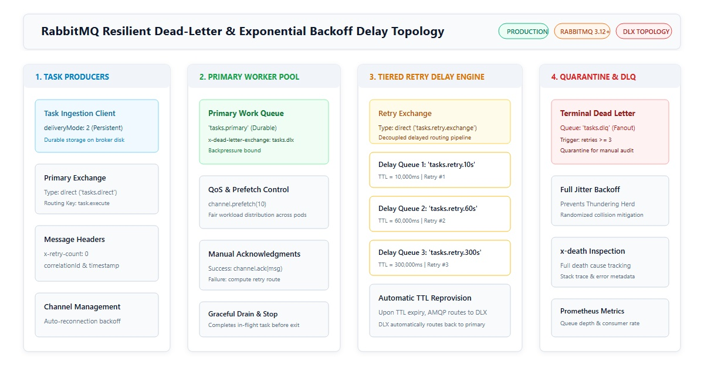

# :rocket: RabbitMQ Dead Letter Retry Worker

<p align="center">
  
</p>

<div align="center">

[]()
[]()
[](LICENSE)
[](https://github.com/tayyabmasood911/rabbitmq-dead-letter-retry-worker/pulls)
[]()

</div>

---

## :memo: Executive Summary

**RabbitMQ Dead Letter Retry Worker** is an enterprise asynchronous task processing architecture built with `amqplib`. Engineered to eliminate task loss, handle transient downstream service failures, and protect message pipelines through an automated **Tiered Exponential Backoff Delay Queue Topology** and **Dead-Letter Exchange (DLX)** quarantine mechanism.

Key operational outcomes:
- **Resilient Retry Topology:** Leverages RabbitMQ message TTL and Dead Letter Exchanges to delay failed messages (10s, 60s, 300s) without blocking worker consumer threads.
- **Thundering Herd Mitigation:** Full jitter randomized backoff prevents synchronized retry stampedes when recovering third-party APIs.
- **Poison-Pill Quarantine:** Tasks exceeding maximum retry thresholds ($N \ge 3$) are automatically routed to a terminal Dead Letter Queue (`tasks.dlq`) with full failure context.
- **Fair-Share Prefetch QoS:** Configured `channel.prefetch(10)` ensures balanced load distribution across distributed worker containers.
- **Durable AMQP Declarations:** All exchanges, queues, and bindings are declared durable with persistent message delivery mode (`deliveryMode: 2`).

---

## :building_construction: System Architecture

```text
+---------------------------------------------------------------------------------------+
|                    RabbitMQ Resilient DLX & Retry Worker Topology                     |
|                                                                                       |
|   [Task Publisher] ===> Direct Exchange ('tasks.direct')                              |
|                                     | (routingKey: task.execute)                      |
|                                     v                                                 |
|                           [Queue: 'tasks.primary']                                    |
|                           (Durable, x-dead-letter-exchange: tasks.dlx)                |
|                                     |                                                 |
|                                     v                                                 |
|                        [Worker Pool (Prefetch: 10)]                                   |
|                                     |                                                 |
|                 +-------------------+-------------------+                             |
|                 | (Success)                             | (Transient Failure)         |
|                 v                                       v                             |
|          [channel.ack(msg)]               [Retry Exchange: 'tasks.retry.exchange']    |
|                                                         |                             |
|                     +-----------------+-----------------+                             |
|                     |                 |                 |                             |
|                     v                 v                 v                             |
|             ['tasks.retry.10s'] ['tasks.retry.60s'] ['tasks.retry.300s']              |
|             (TTL=10s, DLX->Pri) (TTL=60s, DLX->Pri) (TTL=300s, DLX->Pri)             |
|                     |                 |                 |                             |
|                     +--------+--------+                 | (Exhausted Retries >= 3)    |
|                              v                          v                             |
|               (TTL Expired -> Re-enter)     [Dead Letter Exchange: 'tasks.dlx']       |
|                 ['tasks.primary']                       |                             |
|                                                         v                             |
|                                             [Terminal Quarantine: 'tasks.dlq']        |
+---------------------------------------------------------------------------------------+
```

---

## :sparkles: Key Enterprise Capabilities

- :zap: **Non-Blocking Delayed Execution:** Messages sleep inside dedicated broker TTL queues rather than blocking application event loops.
- :shield: **Zero Message Loss:** Disk-persisted delivery mode guarantees survivability across RabbitMQ broker restarts.
- :repeat: **Automatic Channel & Connection Recovery:** Reconnects automatically with exponential backoff on socket dropouts.
- :mag: **Death Header Auditing:** Inspects `x-death` and `x-retry-count` headers to trace the complete failure lifecycle of any task.
- :stop_sign: **Graceful Worker Drain:** Intercepts `SIGINT`/`SIGTERM` to complete in-flight tasks before shutting down AMQP channels.

---

## :file_folder: Repository Directory Structure

```text
.
|-- .github/
|   `-- workflows/
|       `-- ci.yml                   # Automated CI verification workflow
|-- config/
|   `-- production.env.example       # Enterprise production environment variables
|-- docs/
|   `-- images/
|       |-- architecture-white.jpg   # High-resolution white architecture diagram
|       `-- architecture.svg         # Scalable vector architecture diagram
|-- scripts/
|   `-- healthcheck.sh               # Component health check probe
|-- tests/
|   `-- test_validation.py           # Integrity test suite
|-- .gitattributes                   # Linguist language detection mapping
|-- retryStrategy.js                 # DLX topology declaration and backoff logic
|-- consumer.js                      # Resilient AMQP worker with auto-reconnect
|-- publisher.js                     # Persistent task producer utility
|-- package.json                     # Node.js dependencies and operational scripts
|-- Makefile                         # Standard operational targets
|-- SECURITY.md                      # Security vulnerability reporting policy
|-- LICENSE                          # MIT Open Source License
`-- README.md                        # Enterprise documentation
```

---

## :hammer_and_wrench: Operational Runbook & Usage

### 1. Prerequisites
- Node.js `>= 18.0` / npm `>= 9.0`
- RabbitMQ Server `>= 3.10` (with management plugin enabled)

### 2. Installation & Configuration
```bash
# Clone the repository
git clone https://github.com/tayyabmasood911/rabbitmq-dead-letter-retry-worker.git
cd rabbitmq-dead-letter-retry-worker

# Install dependencies
npm install

# Configure environment variables
cp config/production.env.example .env
```

### 3. Running Workers & Producers

#### Start the Worker Consumer
```bash
# Starts consumer and declares full resilient retry/DLX topology
npm run worker
```

#### Dispatch Test Tasks
```bash
# Dispatches sample persistent tasks (including transient failure test cases)
npm run publish
```

### 4. Running Verification Suite
```bash
# Execute automated test suite
make test

# Verify module integrity
npm test
```

---

## :gear: Configuration Reference

| Parameter | Type | Default | Description |
| :--- | :--- | :--- | :--- |
| `RABBITMQ_URL` | string | `amqp://localhost:5672` | RabbitMQ AMQP connection string |
| `PREFETCH_COUNT` | integer | `10` | Worker QoS unacknowledged message limit |
| `ENVIRONMENT` | string | `production` | Deployment environment target (`staging`, `production`) |
| `LOG_LEVEL` | string | `info` | Structured logging verbosity (`debug`, `info`, `warn`, `error`) |

---

## :lock: Security, Compliance & Governance

1. **AMQPS / TLS Encryption:** Supports TLS encrypted AMQP protocol endpoints for cluster interconnects.
2. **Virtual Host Isolation:** Multi-tenant segmentation via dedicated RabbitMQ vhosts and isolated permissions.
3. **Payload Sanitization:** No credentials or unencrypted secrets stored in task message properties or headers.
4. **Quarantine SLA:** Quarantine DLQ monitored via alert manager to notify engineering of persistent business errors.

---

## :bust_in_silhouette: Author & Maintainer

**Tayyab Masood**  
Cloud Solutions Architect & Senior DevOps Engineer  
- :globe_with_meridians: **GitHub:** [@tayyabmasood911](https://github.com/tayyabmasood911)  
- :scroll: **Certification:** AWS Certified Solutions Architect - Associate  

---

## :page_facing_up: License

This project is licensed under the **MIT License** - see the [LICENSE](LICENSE) file for details.
